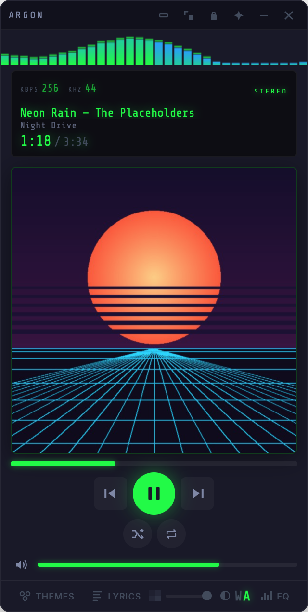
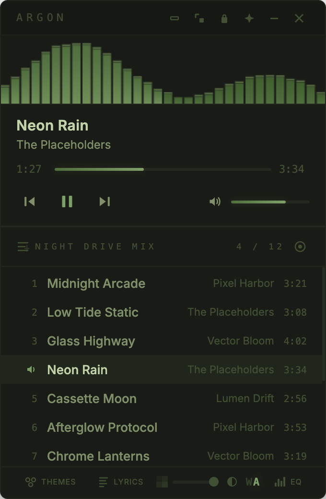
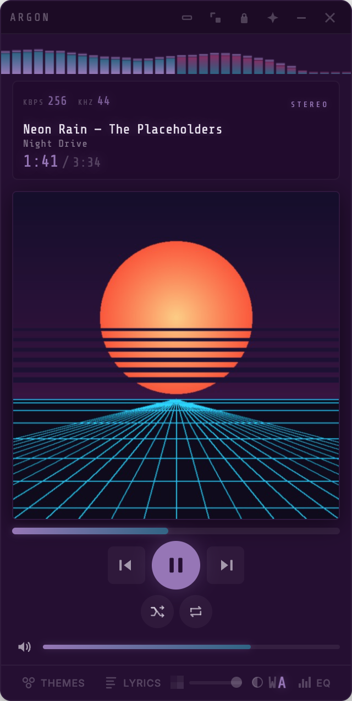
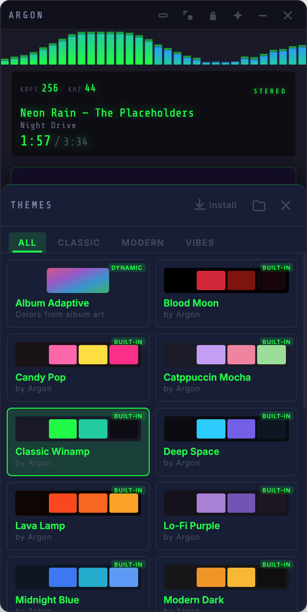
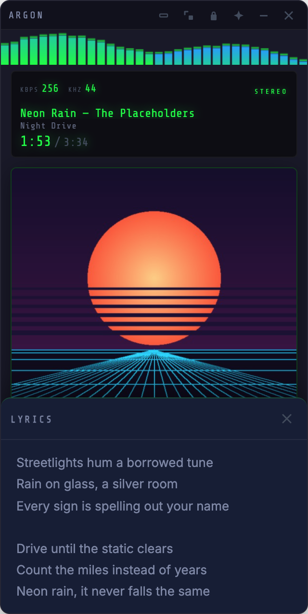
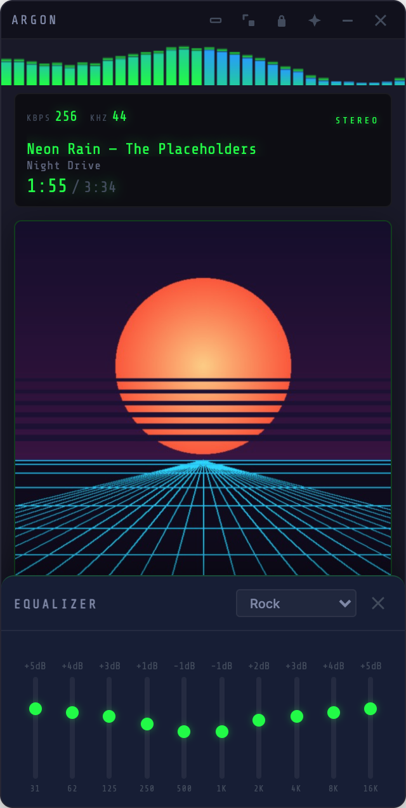

# Argon

Argon is a Winamp-inspired, always-on-top **controller for the Music app on macOS**. It doesn't
play audio itself; it controls Music through AppleScript.

It's a compact, themeable window with a visualizer, playlist view, lyrics, a Winamp-style
windowshade bar and a menu bar menu. It's built with Electron.

[](https://www.electronjs.org/)

[](LICENSE)

<p>
  
  
  
</p>


The screenshots use made-up tracks.

## Features

- **Winamp-style UI** — Compact player with visualizer, seek bar, volume, shuffle/repeat
- **Theme Engine** — 20 built-in themes, user-installable .zip themes, per-theme layout control
- **Adaptive Theme** — Takes its colors from the album art, adjusted for readable contrast
- **Windowshade Mode** — Winamp-style 320×28 bar (resizable 280–600px wide) with transport controls, a seek bar, and the current track
- **Lyrics Display** — Shows the lyrics stored with the track in Music
- **Equalizer Panel** — 10 bands and 10 presets (Rock, Pop, Jazz, Classical, etc.). Visual only for now: it saves your settings but doesn't change the sound. See [Limitations](#limitations).
- **Global Shortcuts** — Media keys and hotkeys work system-wide
- **Menu Bar / Tray** — Click the menu bar icon to bring Argon to the front and open its menu (playback controls and track info); right-click opens the menu without moving Argon
- **Hide Dock Icon** — Optional: uncheck **Show Dock Icon** in the tray menu to keep Argon out of the Dock
- **Track Notifications** — Native macOS notifications on track change
- **Background Transparency** — Adjustable background opacity
- **Dark/Light Text Mode** — Toggle text polarity for any background
- **Playlist Viewer** — Up to 30 tracks around the current one in the playing playlist, click to play. Shown by themes with a playlist layout, such as Terminal Green, Overdrive and Blood Moon.
- **Window Snap** — Snap to bottom-right corner, lock position, always-on-top
- **Visualizer** — Three modes (bars, waveform, spectrum) with theme-aware colors. It's animated, not driven by the audio; see [Limitations](#limitations).

<p>
  
  
  
</p>

## Install

Argon needs:

- **macOS** 10.15 or later (Electron 28's minimum).
- **The Music app**, which comes with macOS.

### Download from GitHub Releases

1. Open the [latest release](https://github.com/ChristianTabor/Argon/releases/latest).
2. Download `Argon-darwin-arm64.zip` for Apple silicon (M1 and later) or
   `Argon-darwin-x64.zip` for Intel.
3. Unzip it and move `Argon.app` to `/Applications`.

**Opening it the first time.** Release builds aren't signed or notarized yet
([#7](https://github.com/ChristianTabor/Argon/issues/7)), so macOS blocks the first launch of
a downloaded copy:

- If macOS says it can't verify Argon, click **Done**. Then open System Settings → Privacy &
  Security, scroll to **Security**, and click **Open Anyway** next to the message about Argon.
- If macOS says **"Argon" is damaged and can't be opened**, the download isn't broken. The
  builds carry only Electron's ad-hoc signature, which macOS rejects for downloaded apps, and
  this message has no Open Anyway button. Remove the download flag in Terminal, then open
  Argon again:

  ```bash
  xattr -dr com.apple.quarantine /Applications/Argon.app
  ```

  Only do this for a copy you downloaded from this repository's Releases page.

### Homebrew

Not available yet. A Homebrew cask is planned in
[#7](https://github.com/ChristianTabor/Argon/issues/7).

### Run from Source

You'll need [Node.js](https://nodejs.org/) (the current LTS release).

```bash
git clone https://github.com/ChristianTabor/Argon.git
cd Argon
npm install
npm start
```

`npm run dev` does the same and opens DevTools in a detached window.

When you run from source, the Automation permission belongs to the app you launched it from
(Terminal, iTerm, VS Code), not to Argon. See [Troubleshooting](#troubleshooting).

### Build .app Bundle

```bash
npm run build
```

This runs `build-and-install.sh`, which is meant for the maintainer's Mac. It regenerates the
icon files in `assets/`, packages **Argon** and **Argon Glass** (the same app with a glass
icon) for your Mac's architecture with `@electron/packager`, and replaces any existing copies
in `/Applications`.

## First Launch: Automation Permission

The first time Argon talks to Music, macOS asks whether **"Argon" wants access to control
"Music"**. Click **Allow**. Argon can't do anything without it.

## Troubleshooting

**It only shows "Open Apple Music to begin".** Argon shows this when Music is stopped, and
also when it can't reach Music at all. Start playing something in Music. If that doesn't
help, check the permission below.

**I clicked Don't Allow.** Open System Settings → Privacy & Security → Automation, find
**Argon**, and turn on **Music**. Or reset the decision and relaunch Argon to get the prompt
again:

```bash
tccutil reset AppleEvents com.tabor.argon
```

**Running from source, nothing works.** The prompt names your terminal or editor, not Argon.
Look under that app in System Settings → Privacy & Security → Automation. To reset it, use its
bundle id: for example `tccutil reset AppleEvents com.apple.Terminal`. This resets every
Automation decision for that app, not just Music.

**Media keys don't work.** Electron can only register media keys on macOS if the app has
Accessibility permission, and Argon doesn't ask for it. Add Argon under System Settings →
Privacy & Security → Accessibility, then relaunch it. A global shortcut also fails silently if
another app has already claimed it.

**No notifications.** Check that notifications are on for Argon in System Settings →
Notifications.

**Music opens by itself.** Argon checks Music twice a second, and AppleScript starts Music if
it isn't running. Quit Argon (menu bar icon → **Quit Argon**) before you quit Music.

## Limitations

- **macOS only, and Music only.** Argon controls the Music app. It doesn't play audio, and it
  doesn't work with Spotify or other players.
- **The visualizer is simulated.** Argon can't read Music's audio, so the visualizer animates
  made-up data. It only follows play and pause.
- **The equalizer doesn't change the sound.** It saves its slider positions and preset, but
  nothing is applied to the audio. Music's own equalizer is separate.
- **Lyrics depend on the track.** Argon shows the lyrics Music has stored for the track.
  Tracks without them show "No lyrics available for this track".
- **The KBPS and KHZ readouts are placeholders.** They always show 256 and 44
  ([#11](https://github.com/ChristianTabor/Argon/issues/11)).
- **Global shortcuts are fixed.** You can't change or turn them off yet
  ([#18](https://github.com/ChristianTabor/Argon/issues/18)).
- **Builds aren't signed or notarized yet.** See [Download from GitHub Releases](#download-from-github-releases).

## Keyboard Shortcuts

### In-App Shortcuts

| Key | Action |
|-----|--------|
| `Space` | Play / Pause |
| `Cmd + Right` | Next Track |
| `Cmd + Left` | Previous Track |
| `Right` | Seek Forward 5s |
| `Left` | Seek Back 5s |
| `Up` | Volume Up |
| `Down` | Volume Down |
| `M` | Mute / Unmute |
| `S` | Toggle Shuffle |
| `R` | Toggle Repeat |
| `T` | Toggle Theme Panel |
| `V` | Cycle Visualizer Mode |
| `D` | Toggle Dark/Light Text |
| `L` | Toggle Lyrics Panel |
| `E` | Toggle Equalizer Panel |

### Global Shortcuts (System-Wide)

| Shortcut | Action |
|----------|--------|
| `Media Play/Pause` | Play / Pause |
| `Media Next` | Next Track |
| `Media Previous` | Previous Track |
| `Cmd + Shift + Up` | Volume Up |
| `Cmd + Shift + Down` | Volume Down |
| `Cmd + Shift + M` | Toggle Windowshade |

## Theme System

Themes are CSS files that override custom properties defined in `base.css`. A theme controls:

- **Colors** — Every color in the UI (`--bg-primary`, `--accent`, `--text-primary`, etc.)
- **Fonts** — Display and UI typefaces (`--font-display`, `--font-ui`)
- **Layout** — Section order, visibility, sizing (`--order-artwork`, `--show-playlist`, etc.)
- **Window** — Size constraints (`--base-width`, `--window-min-height`, etc.)

### Installing Themes

1. Click **Themes** in the bottom bar (or press `T`)
2. Click **Install** to load a `.zip` theme
3. Or drop theme folders into the themes directory (click the folder icon)

### Theme Structure

```
my-theme/
  theme.json    # { "name": "My Theme", "author": "...", "category": "..." }
  theme.css     # CSS custom property overrides
```

The full guide is in [docs/themes.md](docs/themes.md).

## Tech Stack

- **Electron 28** — App shell with native macOS integration
- **AppleScript** via `osascript` — Apple Music control and metadata
- **Vanilla JS** — No frameworks
- **CSS Custom Properties** — Complete theme engine with 80+ variables
- **Canvas API** — Visualizer drawing

## Project Structure

```
argon/
  main.js              # Electron main process (IPC, tray, shortcuts, notifications)
  preload.js           # Context bridge API
  src/
    index.html         # Single-page UI
    js/
      app.js           # Application logic, state, UI binding
      visualizer.js    # Canvas visualizer
      theme-manager.js # Theme loading, switching, adaptive colors
    styles/
      base.css         # Base styles + full CSS variable surface
    themes/            # Built-in theme directories
  docs/                # Architecture, themes, releases, screenshots
  test/                # Jest tests
```

## Documentation

- [Architecture](docs/architecture.md): processes, the IPC reference, the AppleScript bridge,
  polling and prefs
- [Creating themes](docs/themes.md)
- [Releases](docs/release.md)
- [Contributing](CONTRIBUTING.md)
- [Security policy](SECURITY.md)
- [Changelog](CHANGELOG.md)

## License

MIT. See [LICENSE](LICENSE).
