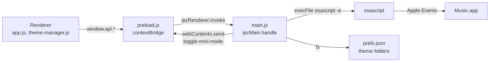

# Architecture

Argon is an Electron app that controls the Music app on macOS. It doesn't play audio. Every
playback action and every piece of track data goes through AppleScript, run by `osascript` in
the main process.

This page describes the code as it is. If you change a channel, a pref or the polling, update
this page in the same PR. `test/docs.test.js` fails if the IPC table, the prefs table or the shortcut groups table
drifts from the code.

## Process model

| Part | Files | Job |
|------|-------|-----|
| Main process | `main.js` | The window, the tray menu, global shortcuts, notifications, the AppleScript bridge, theme files and prefs. Registers every `ipcMain.handle` channel. |
| Preload | `preload.js` | Uses `contextBridge` to expose `window.api` to the page. Each method calls one channel with `ipcRenderer.invoke`, except `onToggleMiniMode`, which listens for an event from main. |
| Renderer | `src/index.html`, `src/js/app.js`, `src/js/theme-manager.js`, `src/js/visualizer.js`, `src/js/favorite.js`, `src/js/playlist-layout.js`, `src/styles/base.css` | The UI. `app.js` holds the player state, polling, panels, windowshade mode and keyboard shortcuts. `theme-manager.js` lists, previews and applies themes. `visualizer.js` draws the canvas visualizer. `favorite.js` holds the Favorite heart's state. `playlist-layout.js` works out the window height for the PL button. |
| Themes | `src/themes/<id>/` | Built-in themes: a `theme.json` and a `theme.css` each. See [themes.md](themes.md). |

The page is loaded with `loadFile`, so it runs from `file://`. The scripts load in this order:
`visualizer.js`, `theme-manager.js`, `favorite.js`, `playlist-layout.js`, `app.js`.
`visualizer.js` and `theme-manager.js` attach their classes to `window`, `favorite.js` defines
global functions, and `playlist-layout.js` sets `window.PlaylistLayout`. The last two also export
with `module.exports`, so the Jest tests run the same code.

### Security settings

The window is created with:

- `contextIsolation: true`
- `sandbox: true`
- `nodeIntegration: false`

The renderer has no Node access. It can only reach the main process through `window.api`.

### Navigation guard

The window stays on Argon's own page:

- `main.js` cancels every `will-navigate` on the window's `webContents`, and its
  `setWindowOpenHandler` denies every new window. Without this, a link or a file dropped on the
  window would load in its place, and that page would get the preload API.
- `app.js` cancels `dragover` and `drop` on the document and sets the drop effect to `none`, so
  drops are ignored before they get that far.

The window is also created with `maximizable: false` and `fullscreenable: false`, so a
double-click on a drag area doesn't zoom it. Double-click is the windowshade toggle.

`src/index.html` sets this Content Security Policy:

```
default-src 'self';
style-src 'self' 'unsafe-inline' https://fonts.googleapis.com;
font-src https://fonts.gstatic.com;
img-src 'self' data:;
script-src 'self';
```

`'unsafe-inline'` styles are needed because theme CSS is injected into a `<style>` element.
`img-src data:` is needed for album artwork, which arrives as a data URL.

### Data flow



## IPC channel reference

Every `invoke` channel (32 today) and the one event from main to renderer are in the tables
below.

Notes that apply to every row:

- "Returns" is what the renderer's promise resolves with. `undefined` means the handler returns
  nothing.
- Handlers built directly on `runAppleScript` reject when `osascript` fails or times out. The
  renderer doesn't catch these, so a failure shows up only as an unhandled rejection in the
  DevTools console.
- `music:getState`, `music:getArtwork`, `music:getPlaylist` and `music:getLyrics` catch their
  own errors and return a fallback value instead.
- `music:toggleFavorite` throws on a bad argument or an unexpected answer. `favorite.js`
  catches that and puts the heart back.
- "Unused" means nothing in `src/` calls the method today.

### `music:*` (Music app)

| Channel | `window.api` method | Arguments | Validation | Returns | AppleScript |
|---------|---------------------|-----------|------------|---------|-------------|
| `music:getState` | `music.getState()` | none | none | `{ state, track, artist, album, duration, position, volume, shuffle, repeat, bitRate, sampleRate, persistentId, favorited }`. `bitRate` (kbps) and `sampleRate` (Hz) are `null` when Music reports 0, `missing value` or anything non-numeric. `persistentId` is `''` unless it's 16 hex digits. On any error: `state: 'stopped'`, empty strings, zeros, `volume: 50`, `shuffle: false`, `repeat: 'off'`, `bitRate` and `sampleRate` `null`, `persistentId: ''`, `favorited: false`. | Reads `player state`, `sound volume`, and when not stopped the current track's `name`, `artist`, `album`, `duration`, plus `player position`, `shuffle enabled` and `song repeat`. Also reads the track's `bit rate`, `sample rate`, `persistent ID` and `favorited`, each in its own `try`, so a track without one still returns the rest. |
| `music:getArtwork` | `music.getArtwork()` | none | none | A `data:image/jpeg;base64,…` URL, or `null` when stopped, when the track has no artwork, or on error. | Writes `data of artwork 1 of current track` to `<temp>/winamp_artwork.jpg`, which main reads back. The MIME type is always `image/jpeg`. |
| `music:play` | `music.play()` | none | none | `osascript` output (ignored) | `play` |
| `music:pause` | `music.pause()` | none | none | `osascript` output (ignored) | `pause` |
| `music:playpause` | `music.playpause()` | none | none | `osascript` output (ignored). Unused: the renderer calls `play` or `pause` based on its own state. | `playpause` |
| `music:next` | `music.next()` | none | none | `osascript` output (ignored) | `next track` |
| `music:prev` | `music.prev()` | none | none | `osascript` output (ignored) | `previous track` |
| `music:setVolume` | `music.setVolume(vol)` | `vol`: 0–100 | `Number(vol)` must be finite and within 0–100, or the handler returns `undefined` without running anything. Rounded. | `osascript` output (ignored) | `set sound volume to <vol>` |
| `music:setPosition` | `music.setPosition(pos)` | `pos`: seconds | `Number(pos)` must be finite and ≥ 0, or the handler returns `undefined`. No upper bound. | `osascript` output (ignored) | `set player position to <pos>` |
| `music:toggleShuffle` | `music.toggleShuffle()` | none | none | `osascript` output (ignored) | `set shuffle enabled to not shuffle enabled` |
| `music:toggleRepeat` | `music.toggleRepeat()` | none | none | The new mode: `'all'`, `'one'` or `'off'`. | Cycles `song repeat`: off → all → one → off. |
| `music:getPlaylist` | `music.getPlaylist()` | none | none | `{ name, currentIndex, count, startIndex, tracks: [{ index, name, artist, duration }] }`, or `null` when stopped or on error. | Reads up to 30 tracks of `current playlist` around the current track. See [The playlist window](#the-playlist-window). |
| `music:playTrackIndex` | `music.playTrackIndex(index)` | `index`: 1-based track index in the current playlist | `Math.round(Number(index))` must be finite and ≥ 1, or the handler returns `undefined`. | `osascript` output (ignored) | `play track <index> of current playlist` |
| `music:getLyrics` | `music.getLyrics()` | none | none | The `lyrics` text of the current track, or `''` when stopped, when there are none, or on error. | `lyrics of current track` |
| `music:toggleFavorite` | `music.toggleFavorite(persistentId)` | `persistentId`: the current track's persistent ID, from `getState` | Must be a string of 16 hex digits, or the handler throws `Invalid track ID`. | The new `favorited` value (`true`/`false`), or `'stale'` if the current track is no longer the one with that ID. Throws on any other answer. | Passes the ID as an argument (`on run argv`), not in the script text. If the current track's `persistent ID` matches, sets `favorited` to `not favorited`. |

### `notify:*` and `tray:*`

| Channel | `window.api` method | Arguments | Validation | Returns | Effect |
|---------|---------------------|-----------|------------|---------|--------|
| `notify:trackChange` | `notifications.trackChange(track, artist, album)` | Three strings | A non-string `track` becomes `Unknown Track`. Non-string `artist` and `album` are dropped. The title is cut to 200 characters and the body to 500. | `undefined` | Shows a silent native notification: title = track, body = `artist — album` (or `Unknown Artist`). Does nothing if notifications aren't supported. |
| `tray:updateTrack` | `tray.updateTrack(track, artist)` | Two strings | None. Falsy values fall back to `Not Playing` and no artist line. | `undefined` | Rebuilds the tray menu with the track and artist as disabled header items. |

### `themes:*`

| Channel | `window.api` method | Arguments | Validation | Returns | Effect |
|---------|---------------------|-----------|------------|---------|--------|
| `themes:list` | `themes.list()` | none | none | An array of `theme.json` objects, each with `id` (folder name), `builtin` and `path` (absolute folder path) added. Built-in themes come first. Folders whose `theme.json` is missing or invalid are skipped. | Creates the user themes folder if needed and reads both theme folders. |
| `themes:load` | `themes.load(id)` | `id`: theme folder name | Must be a non-empty string with no `/`, `\` or `..`, or the handler returns `null`. The resolved path must stay inside one of the two theme folders. | `{ css, meta }`, or `null` when neither folder has both `theme.css` and `theme.json`. Rejects if `theme.json` isn't valid JSON. | Looks in the built-in folder first, so a built-in theme wins over a user theme with the same id. |
| `themes:install` | `themes.install()` | none | The user picks the file in an open dialog. The dialog filters to `.zip` but also offers All Files. The zip's name (without extension) must pass `isSafeThemeName`: non-empty, not `.`, and no `/`, `\` or `..`. After extracting, `containsSymlink` walks the folder and rejects any symlink. See [Theme install checks](#theme-install-checks). | `null` if cancelled. `{ success: true, themeId, name }` on success. `{ success: false, error }` on failure. The renderer doesn't show the error. | Extracts the archive with `unzip -o` into `<userData>/themes/<zip name>/`. If the archive holds a single folder, its contents are moved up one level. With a symlink, or without a `theme.json`, the folder is deleted. An existing folder with the same name is overwritten in place. |
| `themes:openFolder` | `themes.openFolder()` | none | none | `undefined` | Creates the user themes folder if needed and opens it in Finder. |

### `window:*`

| Channel | `window.api` method | Arguments | Validation | Returns | Effect |
|---------|---------------------|-----------|------------|---------|--------|
| `window:minimize` | `window.minimize()` | none | none | `undefined` | Minimizes the window. |
| `window:close` | `window.close()` | none | none | `undefined` | Closes the window. Argon keeps running in the menu bar, and the tray menu (or `Cmd+Shift+M`, when Global Shortcuts is on) brings a new window back. |
| `window:toggleOnTop` | `window.toggleOnTop()` | none | none | The new always-on-top state (`boolean`). | Toggles always-on-top and refreshes the tray menu. Not saved to prefs. |
| `window:snapBottomRight` | `window.snapBottomRight()` | none | none | `undefined` | Moves the window to the bottom-right corner of its display's work area and remembers that it's snapped, so later resizes keep it there until the user drags it. |
| `window:setMinMaxSize` | `window.setMinMaxSize(minW, minH, maxW, maxH)` | Four numbers | None beyond a truthiness check on each pair. | `undefined` | Sets the minimum and maximum size. Unused. |
| `window:resize` | `window.resize(w, h)` | Two numbers | None. Values are rounded. | `undefined` | Resizes the window. Unused. |
| `window:applyConstraints` | `window.applyConstraints(minW, minH, maxW, maxH, targetW, targetH)` | Six numbers | None beyond a truthiness check on each pair. Values are rounded, and the minimum and target heights are capped at the height of the work area of the window's display. | `undefined` | Resets the minimum to 200×200, then sets the maximum, the minimum and the size. Re-snaps if the window was snapped; otherwise moves the window up if its bottom now hangs off the work area. Used when a theme loads, when the PL button toggles the playlist, and when windowshade mode starts or ends. |
| `window:toggleLock` | `window.toggleLock()` | none | none | The new locked state (`boolean`). | Makes the window unmovable or movable. Not saved to prefs. |
| `window:setVibrancy` | `window.setVibrancy(v)` | A vibrancy name or `null` | None. | `undefined` | Passes `v` to `setVibrancy`. A falsy value turns vibrancy off and makes the background fully transparent. The renderer passes `'under-window'` or `null`. |

### `prefs:*`

| Channel | `window.api` method | Arguments | Validation | Returns | Effect |
|---------|---------------------|-----------|------------|---------|--------|
| `prefs:load` | `prefs.load()` | none | none | The parsed contents of `prefs.json`, unfiltered, except that a file without a boolean `mediaKeys` gets `mediaKeys: true` (see [Prefs](#prefs)). If the file is missing or isn't valid JSON: `{ theme: 'classic-winamp', visualizer: 'bars', alwaysOnTop: false, hideDockIcon: false, mediaKeys: false, globalShortcuts: true }`. | Reads the file. |
| `prefs:save` | `prefs.save(prefs)` | An object | Must be a plain object (not `null` or an array), or nothing happens. Only whitelisted keys whose `typeof` matches are kept. See [Prefs](#prefs). | `undefined` | Merges the kept keys into the file on disk, so keys the caller didn't send survive. If the kept keys include `mediaKeys` or `globalShortcuts`, re-registers that shortcut group with the new value. |

### Events from main to renderer

| Channel | `window.api` method | Payload | Sent when |
|---------|---------------------|---------|-----------|
| `toggle-mini-mode` | `onToggleMiniMode(callback)` | None. The preload wrapper calls `callback()` with no arguments, so the IPC event object never reaches the page. | `Cmd+Shift+M` is pressed while the window exists and Global Shortcuts is on. If the window was closed, main creates a new one instead of sending the event. |

## The AppleScript bridge

### `runAppleScript`

```js
function runAppleScript(script, args = [])
execFile('osascript', args.length ? ['-e', script, '--', ...args] : ['-e', script], { timeout: 5000 }, …)
```

- Each call starts a new `osascript` process. There's no long-lived process or scripting
  bridge, so a hung call can't block later ones, and a failed call has no state to clean up.
  The cost is one process spawn per call, which is why polling uses one combined script.
- The timeout is 5 seconds. A timeout rejects the promise.
- The result is `stdout` with surrounding whitespace trimmed.
- `music:getPlaylist` runs its own `execFile` with a 15 second timeout, because reading 30
  tracks is slower.
- The tray menu items and the global shortcuts call `runAppleScript` directly, not through IPC.
- `args` reach the script's `on run argv` handler, after `--`. A value passed this way is never
  part of the script's source.

Scripts are built as template strings. The only values interpolated into them are numbers
that the handler has already validated (`setVolume`, `setPosition`, `playTrackIndex`) and the
artwork temp path, which main builds itself. The one renderer string that reaches a script,
the persistent ID for `music:toggleFavorite`, is checked against 16 hex digits and passed in
`args`, not interpolated.

### Return formats

AppleScript returns one string, so handlers join fields with delimiters and split them in
JavaScript:

- `music:getState` joins 13 fields with `||`:
  `state||track||artist||album||duration||position||volume||shuffle||repeat||bitRate||sampleRate||persistentId||favorited`.
  `duration` and `position` are seconds, `volume` is 0–100, `shuffle` is `true`/`false`,
  `repeat` is `off`/`one`/`all`, `bitRate` is kbps, `sampleRate` is Hz, `persistentId` is 16
  hex digits and `favorited` is `true`/`false`. When stopped, or when Music can't read one of
  the last four, they stay at `0`, `0`, `''` and `false`.
- `music:getPlaylist` returns lines separated by `return`. The first four lines are the playlist
  name, the current track index, the track count and the first index in the window. Each line
  after that is one track: `index<TAB>name<TAB>artist<TAB>seconds`.

Known parsing quirks:

- A track, artist or album name that contains `||` shifts the `getState` fields.
- A playlist or track name that contains a tab or a line break breaks the `getPlaylist` lines.
- `getState` parses volume with `parseInt(…) || 50`, so a volume of exactly 0 is reported as 50.

### The playlist window

`music:getPlaylist` reads at most 30 tracks: it starts 15 before the current track, moves the
window so it doesn't run past either end of the playlist, and returns `startIndex` so the
renderer knows where it begins. `count` is the full length of the playlist. The renderer
shows `currentIndex / count` in the playlist header.

### Automation permission

macOS asks the user once whether Argon may control Music (the Automation, or TCC, prompt).
Until it's allowed, every `osascript` call fails. The fallbacks above then make Argon look
stopped: no track, no artwork, and the "Open Apple Music to begin" text.

- The packaged app's bundle id is `com.tabor.argon`, so `tccutil reset AppleEvents com.tabor.argon`
  clears the decision.
- Running from source (`npm start`), macOS attributes the request to the app that launched
  Electron, usually your terminal or editor. See [CONTRIBUTING.md](../CONTRIBUTING.md#the-automation-permission).

### Music's dictionary

Music's scripting dictionary is the source of truth for property names and values. To read it:

```bash
sdef /System/Applications/Music.app > Music.sdef
```

Or open Music in Script Editor (File → Open Dictionary).

## Polling model

The renderer polls; main never pushes Music state.

- `poll()` in `app.js` calls `music:getState` every 500 ms (`setInterval(poll, 500)`) and once
  at startup. It keeps running while paused, stopped or in windowshade mode.
- `updateUI()` applies each result: the play/pause icon, the visualizer state, the marquee,
  the KBPS/KHZ readouts, the Favorite heart, the album line, the seek bar, the volume, shuffle
  and repeat. Bit rate, sample rate and favorite come with the state, so they cost no extra
  `osascript` call.
- KBPS shows the bit rate rounded (at most 9999). KHZ shows the sample rate in kHz without
  trailing zeros (44100 → `44.1`, 96000 → `96`). Either shows `--` when Music doesn't report
  it.
- When the track name changes, `poll()` also:
  - fetches the artwork (`music:getArtwork`);
  - fetches the playlist (`music:getPlaylist`);
  - sends a notification (`notify:trackChange`), once per track name;
  - updates the tray menu (`tray:updateTrack`);
  - fetches lyrics (`music:getLyrics`) if the lyrics panel is open. Opening the panel also
    fetches them if the track changed since the last fetch.
- The playlist is also fetched once, 1.5 s after startup.

Track changes are detected by name only, so two different tracks with the same name in a row
don't count as a change.

### The seek bar

The seek bar doesn't animate from polls. `setSeekPosition()` jumps the fill to the current
position, then starts a CSS `linear` transition to 100% that lasts for the rest of the track.
The time text is updated from a `requestAnimationFrame` loop that adds elapsed time to the
starting position.

On each poll `updateUI()` restarts the transition only when:

- the track changed;
- play state changed; or
- the polled position differs from the expected position by more than 1.5 s (a seek, or drift).

While the user drags the seek bar, polls don't touch it.

When a poll reports no duration (stopped, the end of a playlist, a live stream), the ticker
stops and the time shows the polled position, or `0:00` when stopped.

### The time readout

`renderTime()` is the one place the time display and the inline seek time are written. Clicking
either one toggles `state.timeMode` between `elapsed` (`1:23`) and `remaining` (`-2:01`), and
saves it to the `timeMode` pref. Remaining is counted in whole seconds, so elapsed plus
remaining always adds up to the total shown, and the end of a track reads `0:00`. Without a
duration it always shows elapsed. Times of an hour or more read `h:mm:ss`.

### The title marquee

A title too wide for the display scrolls. Clicking it pauses or resumes the scroll, and
Shift+click reverses its direction from where it is. A title that fits doesn't scroll, so
clicks do nothing. With Reduce Motion on, a scrolling title starts paused. A new track resets
both.

### The visualizer

The visualizer doesn't read audio. Argon can't get at Music's audio stream, so
`Visualizer.generateData()` makes up bar heights from sine waves and random noise.

It follows Music's player state, which `updateUI()` passes to `setState()`:

- `playing`: animated bars.
- `fast forwarding` and `rewinding` become `seeking`: the bars flutter at random.
- `paused` and `stopped`: the bars fall to flat in about 300 ms, and then the animation loop
  stops. It starts again on the next state change, resize, mode change or color change.
- A track change (`trackChanged()`) leaves 150 ms of silence before the new track's bars.
- While the window is hidden or minimized it doesn't animate.
- With Reduce Motion on it draws one static, low frame instead of animating.

Modes are `bars`, `wave` and `spectrum`. `V` or the mode button cycles them, and the mode is
saved to the `visualizer` pref and restored at startup. Colors come from the theme's
`--viz-color-1/2/3`. They're read once and re-read on `themechange` or when the styles in
`<head>` change, not on every frame.

## Prefs

Prefs live in one JSON file: `app.getPath('userData')/prefs.json`. Electron names that folder
after `name` in `package.json`, so it's `~/Library/Application Support/argon/prefs.json` for
both the packaged app and `npm start`. They share prefs and user themes.

How reads and writes work:

- `prefs:load` returns the whole file as is, or the defaults below if it's missing or invalid.
- Most of the renderer saves by calling `prefs.load()`, changing one key and calling
  `prefs.save()` with the whole object. The visualizer mode and the PL button send only their
  own key, which works because `prefs:save` merges.
- `prefs:save` keeps only the keys in the `allowed` whitelist in `main.js` whose `typeof`
  matches, then merges them into the file. Other keys in the object are dropped silently.
- The tray menu writes `hideDockIcon`, `mediaKeys` and `globalShortcuts` directly with
  `updatePrefs()`, which merges the same way.
- `prefs:save` with `mediaKeys` or `globalShortcuts` in it re-registers that shortcut group, so a
  change applies right away. Because most saves send the whole file back, that happens on most
  saves, with the values already in the file.
- `loadPrefs()` sets `mediaKeys: true` when a file exists but has no boolean `mediaKeys`.
  Installs from before the setting existed captured the media keys, so they keep doing so. New
  installs start with it off.

**Rule: a new pref must be added to `allowed` in `main.js`, or `prefs:save` silently drops it.**
Add it to the table below too.

| Key | Type | Default | Owner | Restored at startup? |
|-----|------|---------|-------|----------------------|
| `theme` | `string` | `'classic-winamp'` | `theme-manager.js` (`applyTheme`) | Yes. `_adaptive` means Album Adaptive. |
| `visualizer` | `string` | `'bars'` | `app.js` (`cycleVizMode`: `V` or the mode button) | Yes, unless the user changes the mode before the prefs load. |
| `alwaysOnTop` | `boolean` | `false` | none | No. Nothing reads or writes it. The window always starts not on top. |
| `transparency` | `number` | not set (100) | `app.js` (transparency slider, 10–100 in steps of 5) | Yes. Below 100 turns off vibrancy and applies the opacity. |
| `darkText` | `boolean` | not set (`false`) | `app.js` (text mode button, `D`) | Yes. |
| `eqBands` | `object` (an array of 10 numbers, −12 to 12) | not set (all 0) | `app.js` (EQ panel) | Yes, if it has 10 entries. Restores the slider positions only. |
| `eqPreset` | `string` | not set | `app.js` (EQ panel). `''` after a slider is moved by hand. | Yes. |
| `miniMode` | `boolean` | not set (`false`) | `app.js` (`toggleMiniMode`) | Yes. Argon starts in windowshade mode. |
| `hideDockIcon` | `boolean` | `false` | `main.js` (tray menu → Show Dock Icon) | Yes, before the window is created. |
| `timeMode` | `string` (`'elapsed'` or `'remaining'`) | not set (`'elapsed'`) | `app.js` (`toggleTimeMode`: click the time) | Yes. Any other value is ignored. |
| `mediaKeys` | `boolean` | `false` for a new install; `true` for a prefs file without it | `main.js` (tray menu → Capture Media Keys) | Yes, at startup. |
| `globalShortcuts` | `boolean` | `true` | `main.js` (tray menu → Global Shortcuts (Cmd+Shift)) | Yes, at startup. Missing counts as on. |
| `playlistVisible` | `boolean` | not set (follow the theme) | `app.js` (`togglePlaylist`: the PL button or `P`) | Yes, before the first theme loads. Kept across theme changes. |

"Not set" means the key isn't in the default object, and the code treats it as missing.

The EQ only stores slider values. It doesn't change the audio.

## Themes

`ThemeManager` (`theme-manager.js`):

- lists themes with `themes:list` and groups them into tabs by their `category`;
- applies a theme by putting its CSS into `<style id="theme-styles">`;
- saves the choice to `theme`, then fires a `themechange` event on `window`. `app.js` handles it:
  it updates the PL button, resizes the window with `applyWindowConstraints()` (which reads the
  size variables and allows for the playlist), and re-applies transparency and dark text;
- previews a theme while its card is hovered or focused (see below).

Theme CSS is read once per panel open and cached by id, so hovering and then clicking a card
reads the disk once.

### Hover preview

Hovering or focusing a card for 150 ms writes a preview into its own
`<style id="theme-preview-styles">`, placed right after `theme-styles`. A preview takes only
color variables from the theme's `:root` blocks (the `PREVIEW_COLOR_VARS` allowlist in
`theme-manager.js`), so layout, sizes and fonts don't change and the window isn't resized. It
saves nothing and fires a `themepreview` event instead of `themechange`, which `app.js` uses to
re-apply transparency and dark text (and, for Album Adaptive, to build colors from the current
artwork). Leaving the card, Escape, closing the panel, the window losing focus, or clicking a
card empties the preview element. Moving from card to card keeps the old preview up until the
next one is ready, so the committed theme doesn't flash in between.

### Theme install checks

`themes:install` takes the theme id from the zip's file name, so it checks that first.
`isSafeThemeName` follows the `themes:load` rule (non-empty, no `/`, `\` or `..`) and also
refuses `.`. Without it, a zip named `..zip` would resolve to the themes folder or `userData`
itself, which a failed install then deletes.

After `unzip`, `containsSymlink` walks the extracted folder with `lstat`. A symlink anywhere
deletes the folder and fails the install, before the nested-folder step or `themes:load` could
read through it.

Album Adaptive (`_adaptive`) isn't a folder. `app.js` samples the artwork on a 64×64 canvas,
picks an accent, a secondary and a dark background color, lightens or darkens the text colors
toward a WCAG contrast ratio against that background, and writes a generated `:root` block
into the same `<style>` element on each artwork change.

See [themes.md](themes.md) for the theme format.

## Favorite (`favorite.js`)

The heart sits in the KBPS/KHZ/STEREO row. It's hidden while stopped and when Music gives no
persistent ID, and a theme can remove it with `--show-favorite: none`. `F` toggles it too, but
not on key repeat or with Cmd, Ctrl or Alt held (`isFavoriteKey`).

`createFavoriteController({ toggle, paint })` keeps the state, so it can be tested without the
page:

- `update(id, favorited)` runs on every poll. While a toggle is in flight the heart doesn't
  follow polls, unless the track changed; then it follows the new track straight away.
- `click()` flips the heart at once, then calls `music:toggleFavorite` with the ID it showed.
  It takes Music's answer if that track is still current, and puts the old value back on
  `'stale'` or an error. A second click while one is in flight does nothing.

## Playlist toggle (`playlist-layout.js`)

The **PL** button in the bottom bar and the `P` key (not on key repeat) show or hide the
playlist viewer. Neither does anything in windowshade mode.

- A theme's `--show-playlist` is its default. The user's choice is saved to `playlistVisible`
  and overrides the theme in every theme. `resolvePlaylistVisible()` picks the override when
  there is one.
- `app.js` marks a real difference from the theme with the classes `playlist-forced-on` and
  `playlist-forced-off` on `#player`, so an override that matches the theme leaves its layout
  alone.
- `--show-playlist-toggle: none` removes the button from a theme.
- Opening the playlist fetches it if it hasn't been fetched yet.

`playlistWindowHeights()` decides the window's minimum and target height:

- A theme that hides the playlist gets `PLAYLIST_EXTRA_HEIGHT` (220 px) more minimum height when
  the user turns it on, never above `--window-max-height`. The window grows only as far as it
  needs and never shrinks a window the user made taller. The height from before is kept.
- Turning it off puts that height back. After a theme load, the window starts from the theme's
  base height instead.
- `window:applyConstraints` then caps the heights at the screen's work area.

## Tray and global shortcuts

The tray icon is drawn in code as an 18×18 template image. The menu shows:

- the track and artist;
- Play/Pause, Next Track and Previous Track;
- Show Window or Hide Window, depending on whether the window is in front;
- Show Dock Icon (a checkbox, saved as `hideDockIcon`);
- Capture Media Keys (a checkbox, saved as `mediaKeys`);
- Global Shortcuts (Cmd+Shift) (a checkbox, saved as `globalShortcuts`);
- problem lines, when a shortcut that's on isn't working (see below);
- Quit Argon.

A click brings the window up and opens the menu. A right-click or Control-click opens the menu
without moving the window.

Closing the window doesn't quit Argon while the tray exists. **Quit Argon** in the tray menu
does.

### Shortcut groups

Global shortcuts come in two groups, `SHORTCUT_GROUPS` in `main.js`. Each group is turned on or
off as a whole by `setShortcutGroup(group, enabled)`, which unregisters the group's
accelerators and registers them again if it's on. Startup applies both prefs, and everything is
released on quit.

| Group | Pref (default) | Tray item | Shortcut | Action |
|-------|----------------|-----------|----------|--------|
| `media` | `mediaKeys` (off for new installs) | Capture Media Keys | `MediaPlayPause` | `playpause` |
| | | | `MediaNextTrack` | `next track` |
| | | | `MediaPreviousTrack` | `previous track` |
| `global` | `globalShortcuts` (on) | Global Shortcuts (Cmd+Shift) | `Cmd+Shift+Up` | Volume +5 |
| | | | `Cmd+Shift+Down` | Volume −5 |
| | | | `Cmd+Shift+M` | Toggle windowshade mode (sends `toggle-mini-mode`), or reopen a closed window |

The media keys only register once Argon is a trusted Accessibility client
(`systemPreferences.isTrustedAccessibilityClient`). Turning Capture Media Keys on from the tray
lets macOS ask for that permission; startup checks without asking.

Problems show up in the tray menu, below the checkboxes:

- **Media Keys Need Accessibility Permission…** when the media keys are on but Argon isn't
  trusted. It opens System Settings → Privacy & Security → Accessibility.
- **In use by another app: …** (disabled) lists the shortcuts that are on but that
  `globalShortcut.register` refused, such as `Cmd+Shift+Up`. A media key refused for lack of
  Accessibility isn't listed here.
