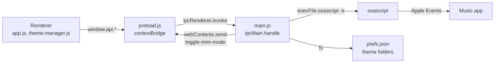

# Architecture

Argon is an Electron app that controls the Music app on macOS. It doesn't play audio. Every
playback action and every piece of track data goes through AppleScript, run by `osascript` in
the main process.

This page describes the code as it is. If you change a channel, a pref or the polling, update
this page in the same PR. `test/docs.test.js` fails if the IPC table or the prefs table drifts
from the code.

## Process model

| Part | Files | Job |
|------|-------|-----|
| Main process | `main.js` | The window, the tray menu, global shortcuts, notifications, the AppleScript bridge, theme files and prefs. Registers every `ipcMain.handle` channel. |
| Preload | `preload.js` | Uses `contextBridge` to expose `window.api` to the page. Each method calls one channel with `ipcRenderer.invoke`, except `onToggleMiniMode`, which listens for an event from main. |
| Renderer | `src/index.html`, `src/js/app.js`, `src/js/theme-manager.js`, `src/js/visualizer.js`, `src/styles/base.css` | The UI. `app.js` holds the player state, polling, panels, windowshade mode and keyboard shortcuts. `theme-manager.js` lists and applies themes. `visualizer.js` draws the canvas visualizer. |
| Themes | `src/themes/<id>/` | Built-in themes: a `theme.json` and a `theme.css` each. See [themes.md](themes.md). |

The page is loaded with `loadFile`, so it runs from `file://`. The scripts load in this order:
`visualizer.js`, `theme-manager.js`, `app.js`. The first two attach their classes to `window`.

### Security settings

The window is created with:

- `contextIsolation: true`
- `sandbox: true`
- `nodeIntegration: false`

The renderer has no Node access. It can only reach the main process through `window.api`.

`src/index.html` sets this Content Security Policy:

```
default-src 'self';
style-src 'self' 'unsafe-inline' https://fonts.googleapis.com;
font-src https://fonts.gstatic.com;
img-src 'self' data:;
script-src 'self';
```

`'unsafe-inline'` styles are needed because theme CSS is injected into a `<style>` element.
`img-src data:` is needed for album artwork, which arrives as a data URL.

### Data flow



## IPC channel reference

Every `invoke` channel (31 today) and the one event from main to renderer are in the tables
below.

Notes that apply to every row:

- "Returns" is what the renderer's promise resolves with. `undefined` means the handler returns
  nothing.
- Handlers built directly on `runAppleScript` reject when `osascript` fails or times out. The
  renderer doesn't catch these, so a failure shows up only as an unhandled rejection in the
  DevTools console.
- `music:getState`, `music:getArtwork`, `music:getPlaylist` and `music:getLyrics` catch their
  own errors and return a fallback value instead.
- "Unused" means nothing in `src/` calls the method today.

### `music:*` (Music app)

| Channel | `window.api` method | Arguments | Validation | Returns | AppleScript |
|---------|---------------------|-----------|------------|---------|-------------|
| `music:getState` | `music.getState()` | none | none | `{ state, track, artist, album, duration, position, volume, shuffle, repeat }`. On any error: `state: 'stopped'`, empty strings, zeros, `volume: 50`, `shuffle: false`, `repeat: 'off'`. | Reads `player state`, `sound volume`, and when not stopped the current track's `name`, `artist`, `album`, `duration`, plus `player position`, `shuffle enabled` and `song repeat`. |
| `music:getArtwork` | `music.getArtwork()` | none | none | A `data:image/jpeg;base64,…` URL, or `null` when stopped, when the track has no artwork, or on error. | Writes `data of artwork 1 of current track` to `<temp>/winamp_artwork.jpg`, which main reads back. The MIME type is always `image/jpeg`. |
| `music:play` | `music.play()` | none | none | `osascript` output (ignored) | `play` |
| `music:pause` | `music.pause()` | none | none | `osascript` output (ignored) | `pause` |
| `music:playpause` | `music.playpause()` | none | none | `osascript` output (ignored). Unused: the renderer calls `play` or `pause` based on its own state. | `playpause` |
| `music:next` | `music.next()` | none | none | `osascript` output (ignored) | `next track` |
| `music:prev` | `music.prev()` | none | none | `osascript` output (ignored) | `previous track` |
| `music:setVolume` | `music.setVolume(vol)` | `vol`: 0–100 | `Number(vol)` must be finite and within 0–100, or the handler returns `undefined` without running anything. Rounded. | `osascript` output (ignored) | `set sound volume to <vol>` |
| `music:setPosition` | `music.setPosition(pos)` | `pos`: seconds | `Number(pos)` must be finite and ≥ 0, or the handler returns `undefined`. No upper bound. | `osascript` output (ignored) | `set player position to <pos>` |
| `music:toggleShuffle` | `music.toggleShuffle()` | none | none | `osascript` output (ignored) | `set shuffle enabled to not shuffle enabled` |
| `music:toggleRepeat` | `music.toggleRepeat()` | none | none | The new mode: `'all'`, `'one'` or `'off'`. | Cycles `song repeat`: off → all → one → off. |
| `music:getPlaylist` | `music.getPlaylist()` | none | none | `{ name, currentIndex, count, startIndex, tracks: [{ index, name, artist, duration }] }`, or `null` when stopped or on error. | Reads up to 30 tracks of `current playlist` around the current track. See [The playlist window](#the-playlist-window). |
| `music:playTrackIndex` | `music.playTrackIndex(index)` | `index`: 1-based track index in the current playlist | `Math.round(Number(index))` must be finite and ≥ 1, or the handler returns `undefined`. | `osascript` output (ignored) | `play track <index> of current playlist` |
| `music:getLyrics` | `music.getLyrics()` | none | none | The `lyrics` text of the current track, or `''` when stopped, when there are none, or on error. | `lyrics of current track` |

### `notify:*` and `tray:*`

| Channel | `window.api` method | Arguments | Validation | Returns | Effect |
|---------|---------------------|-----------|------------|---------|--------|
| `notify:trackChange` | `notifications.trackChange(track, artist, album)` | Three strings | A non-string `track` becomes `Unknown Track`. Non-string `artist` and `album` are dropped. The title is cut to 200 characters and the body to 500. | `undefined` | Shows a silent native notification: title = track, body = `artist — album` (or `Unknown Artist`). Does nothing if notifications aren't supported. |
| `tray:updateTrack` | `tray.updateTrack(track, artist)` | Two strings | None. Falsy values fall back to `Not Playing` and no artist line. | `undefined` | Rebuilds the tray menu with the track and artist as disabled header items. |

### `themes:*`

| Channel | `window.api` method | Arguments | Validation | Returns | Effect |
|---------|---------------------|-----------|------------|---------|--------|
| `themes:list` | `themes.list()` | none | none | An array of `theme.json` objects, each with `id` (folder name), `builtin` and `path` (absolute folder path) added. Built-in themes come first. Folders whose `theme.json` is missing or invalid are skipped. | Creates the user themes folder if needed and reads both theme folders. |
| `themes:load` | `themes.load(id)` | `id`: theme folder name | Must be a non-empty string with no `/`, `\` or `..`, or the handler returns `null`. The resolved path must stay inside one of the two theme folders. | `{ css, meta }`, or `null` when neither folder has both `theme.css` and `theme.json`. Rejects if `theme.json` isn't valid JSON. | Looks in the built-in folder first, so a built-in theme wins over a user theme with the same id. |
| `themes:install` | `themes.install()` | none | The user picks the file in an open dialog. The dialog filters to `.zip` but also offers All Files. | `null` if cancelled. `{ success: true, themeId, name }` on success. `{ success: false, error }` on failure. | Extracts the archive with `unzip -o` into `<userData>/themes/<zip name>/`. If the archive holds a single folder, its contents are moved up one level. Without a `theme.json` the folder is deleted. An existing folder with the same name is overwritten in place. |
| `themes:openFolder` | `themes.openFolder()` | none | none | `undefined` | Creates the user themes folder if needed and opens it in Finder. |

### `window:*`

| Channel | `window.api` method | Arguments | Validation | Returns | Effect |
|---------|---------------------|-----------|------------|---------|--------|
| `window:minimize` | `window.minimize()` | none | none | `undefined` | Minimizes the window. |
| `window:close` | `window.close()` | none | none | `undefined` | Closes the window. Argon keeps running in the menu bar, and the tray menu or `Cmd+Shift+M` brings a new window back. |
| `window:toggleOnTop` | `window.toggleOnTop()` | none | none | The new always-on-top state (`boolean`). | Toggles always-on-top and refreshes the tray menu. Not saved to prefs. |
| `window:snapBottomRight` | `window.snapBottomRight()` | none | none | `undefined` | Moves the window to the bottom-right corner of its display's work area and remembers that it's snapped, so later resizes keep it there until the user drags it. |
| `window:setMinMaxSize` | `window.setMinMaxSize(minW, minH, maxW, maxH)` | Four numbers | None beyond a truthiness check on each pair. | `undefined` | Sets the minimum and maximum size. Unused. |
| `window:resize` | `window.resize(w, h)` | Two numbers | None. Values are rounded. | `undefined` | Resizes the window. Unused. |
| `window:applyConstraints` | `window.applyConstraints(minW, minH, maxW, maxH, targetW, targetH)` | Six numbers | None beyond a truthiness check on each pair. Values are rounded. | `undefined` | Resets the minimum to 200×200, then sets the maximum, the minimum and the size. Re-snaps if the window was snapped. Used when a theme loads and when windowshade mode starts or ends. |
| `window:toggleLock` | `window.toggleLock()` | none | none | The new locked state (`boolean`). | Makes the window unmovable or movable. Not saved to prefs. |
| `window:setVibrancy` | `window.setVibrancy(v)` | A vibrancy name or `null` | None. | `undefined` | Passes `v` to `setVibrancy`. A falsy value turns vibrancy off and makes the background fully transparent. The renderer passes `'under-window'` or `null`. |

### `prefs:*`

| Channel | `window.api` method | Arguments | Validation | Returns | Effect |
|---------|---------------------|-----------|------------|---------|--------|
| `prefs:load` | `prefs.load()` | none | none | The parsed contents of `prefs.json`, unfiltered. If the file is missing or isn't valid JSON: `{ theme: 'classic-winamp', visualizer: 'bars', alwaysOnTop: false, hideDockIcon: false }`. | Reads the file. |
| `prefs:save` | `prefs.save(prefs)` | An object | Must be a plain object (not `null` or an array), or nothing happens. Only whitelisted keys whose `typeof` matches are kept. See [Prefs](#prefs). | `undefined` | Merges the kept keys into the file on disk, so keys the caller didn't send survive. |

### Events from main to renderer

| Channel | `window.api` method | Payload | Sent when |
|---------|---------------------|---------|-----------|
| `toggle-mini-mode` | `onToggleMiniMode(callback)` | None. The preload wrapper calls `callback()` with no arguments, so the IPC event object never reaches the page. | `Cmd+Shift+M` is pressed while the window exists. If the window was closed, main creates a new one instead of sending the event. |

## The AppleScript bridge

### `runAppleScript`

```js
execFile('osascript', ['-e', script], { timeout: 5000 }, …)
```

- Each call starts a new `osascript` process. There's no long-lived process or scripting
  bridge, so a hung call can't block later ones, and a failed call has no state to clean up.
  The cost is one process spawn per call, which is why polling uses one combined script.
- The timeout is 5 seconds. A timeout rejects the promise.
- The result is `stdout` with surrounding whitespace trimmed.
- `music:getPlaylist` runs its own `execFile` with a 15 second timeout, because reading 30
  tracks is slower.
- The tray menu items and the global shortcuts call `runAppleScript` directly, not through IPC.

Scripts are built as template strings. The only values interpolated into them are numbers
that the handler has already validated (`setVolume`, `setPosition`, `playTrackIndex`) and the
artwork temp path, which main builds itself. No renderer string ever reaches a script.

### Return formats

AppleScript returns one string, so handlers join fields with delimiters and split them in
JavaScript:

- `music:getState` joins nine fields with `||`:
  `state||track||artist||album||duration||position||volume||shuffle||repeat`.
  `duration` and `position` are seconds, `volume` is 0–100, `shuffle` is `true`/`false`, and
  `repeat` is `off`/`one`/`all`.
- `music:getPlaylist` returns lines separated by `return`. The first four lines are the playlist
  name, the current track index, the track count and the first index in the window. Each line
  after that is one track: `index<TAB>name<TAB>artist<TAB>seconds`.

Known parsing quirks:

- A track, artist or album name that contains `||` shifts the `getState` fields.
- A playlist or track name that contains a tab or a line break breaks the `getPlaylist` lines.
- `getState` parses volume with `parseInt(…) || 50`, so a volume of exactly 0 is reported as 50.

### The playlist window

`music:getPlaylist` reads at most 30 tracks: it starts 15 before the current track, moves the
window so it doesn't run past either end of the playlist, and returns `startIndex` so the
renderer knows where it begins. `count` is the full length of the playlist. The renderer
shows `currentIndex / count` in the playlist header.

### Automation permission

macOS asks the user once whether Argon may control Music (the Automation, or TCC, prompt).
Until it's allowed, every `osascript` call fails. The fallbacks above then make Argon look
stopped: no track, no artwork, and the "Open Apple Music to begin" text.

- The packaged app's bundle id is `com.tabor.argon`, so `tccutil reset AppleEvents com.tabor.argon`
  clears the decision.
- Running from source (`npm start`), macOS attributes the request to the app that launched
  Electron, usually your terminal or editor. See [CONTRIBUTING.md](../CONTRIBUTING.md#the-automation-permission).

### Music's dictionary

Music's scripting dictionary is the source of truth for property names and values. To read it:

```bash
sdef /System/Applications/Music.app > Music.sdef
```

Or open Music in Script Editor (File → Open Dictionary).

## Polling model

The renderer polls; main never pushes Music state.

- `poll()` in `app.js` calls `music:getState` every 500 ms (`setInterval(poll, 500)`) and once
  at startup. It keeps running while paused, stopped or in windowshade mode.
- `updateUI()` applies each result: the play/pause icon, the marquee, the album line, the seek
  bar, the volume, shuffle and repeat.
- When the track name changes, `poll()` also:
  - fetches the artwork (`music:getArtwork`);
  - fetches the playlist (`music:getPlaylist`);
  - sends a notification (`notify:trackChange`), once per track name;
  - updates the tray menu (`tray:updateTrack`);
  - fetches lyrics (`music:getLyrics`) if the lyrics panel is open. Opening the panel also
    fetches them if the track changed since the last fetch.
- The playlist is also fetched once, 1.5 s after startup.

Track changes are detected by name only, so two different tracks with the same name in a row
don't count as a change.

### The seek bar

The seek bar doesn't animate from polls. `setSeekPosition()` jumps the fill to the current
position, then starts a CSS `linear` transition to 100% that lasts for the rest of the track.
The time text is updated from a `requestAnimationFrame` loop that adds elapsed time to the
starting position.

On each poll `updateUI()` restarts the transition only when:

- the track changed;
- play state changed; or
- the polled position differs from the expected position by more than 1.5 s (a seek, or drift).

While the user drags the seek bar, polls don't touch it.

### The visualizer

The visualizer doesn't read audio. Argon can't get at Music's audio stream, so
`Visualizer.generateData()` makes up bar heights from sine waves and random noise while
playing, and lets them fall to zero when paused. It redraws every animation frame. Modes are
`bars`, `wave` and `spectrum` (`V` or the mode button cycles them), and colors come from the
theme's `--viz-color-1/2/3`.

## Prefs

Prefs live in one JSON file: `app.getPath('userData')/prefs.json`. Electron names that folder
after `name` in `package.json`, so it's `~/Library/Application Support/argon/prefs.json` for
both the packaged app and `npm start`. They share prefs and user themes.

How reads and writes work:

- `prefs:load` returns the whole file as is, or the defaults below if it's missing or invalid.
- The renderer saves by calling `prefs.load()`, changing one key and calling `prefs.save()`
  with the whole object.
- `prefs:save` keeps only the keys in the `allowed` whitelist in `main.js` whose `typeof`
  matches, then merges them into the file. Other keys in the object are dropped silently.
- The tray menu writes `hideDockIcon` directly with `updatePrefs()`, which merges the same way.

**Rule: a new pref must be added to `allowed` in `main.js`, or `prefs:save` silently drops it.**
Add it to the table below too.

| Key | Type | Default | Owner | Restored at startup? |
|-----|------|---------|-------|----------------------|
| `theme` | `string` | `'classic-winamp'` | `theme-manager.js` (`applyTheme`) | Yes. `_adaptive` means Album Adaptive. |
| `visualizer` | `string` | `'bars'` | none | No. Nothing reads or writes it. The visualizer always starts in `bars`. |
| `alwaysOnTop` | `boolean` | `false` | none | No. Nothing reads or writes it. The window always starts not on top. |
| `transparency` | `number` | not set (100) | `app.js` (transparency slider, 10–100 in steps of 5) | Yes. Below 100 turns off vibrancy and applies the opacity. |
| `darkText` | `boolean` | not set (`false`) | `app.js` (text mode button, `D`) | Yes. |
| `eqBands` | `object` (an array of 10 numbers, −12 to 12) | not set (all 0) | `app.js` (EQ panel) | Yes, if it has 10 entries. Restores the slider positions only. |
| `eqPreset` | `string` | not set | `app.js` (EQ panel). `''` after a slider is moved by hand. | Yes. |
| `miniMode` | `boolean` | not set (`false`) | `app.js` (`toggleMiniMode`) | Yes. Argon starts in windowshade mode. |
| `hideDockIcon` | `boolean` | `false` | `main.js` (tray menu → Show Dock Icon) | Yes, before the window is created. |

"Not set" means the key isn't in the default object, and the code treats it as missing.

The EQ only stores slider values. It doesn't change the audio.

## Themes

`ThemeManager` (`theme-manager.js`):

- lists themes with `themes:list` and groups them into tabs by their `category`;
- applies a theme by putting its CSS into `<style id="theme-styles">`, reading the window size
  variables from the CSS text and calling `window:applyConstraints`;
- saves the choice to `theme`, then fires a `themechange` event on `window` that `app.js` uses
  to re-apply transparency, dark text and the window constraints.

Album Adaptive (`_adaptive`) isn't a folder. `app.js` samples the artwork on a 64×64 canvas,
picks an accent, a secondary and a dark background color, lightens or darkens the text colors
toward a WCAG contrast ratio against that background, and writes a generated `:root` block
into the same `<style>` element on each artwork change.

See [themes.md](themes.md) for the theme format.

## Tray and global shortcuts

The tray icon is drawn in code as an 18×18 template image. The menu shows the track and
artist, Play/Pause, Next Track, Previous Track, Show/Hide Window, Show Dock Icon and Quit
Argon. A click brings the window up and opens the menu. A right-click or Control-click opens
the menu without moving the window.

Closing the window doesn't quit Argon while the tray exists. **Quit Argon** in the tray menu
does.

Global shortcuts are registered at startup and released on quit:

| Shortcut | Action |
|----------|--------|
| `MediaPlayPause` | `playpause` |
| `MediaNextTrack` | `next track` |
| `MediaPreviousTrack` | `previous track` |
| `Cmd+Shift+Up` | Volume +5 |
| `Cmd+Shift+Down` | Volume −5 |
| `Cmd+Shift+M` | Toggle windowshade mode (sends `toggle-mini-mode`) |

`globalShortcut.register` returns `false` when another app already holds a shortcut. Argon
doesn't check the result, so a taken shortcut fails silently.
